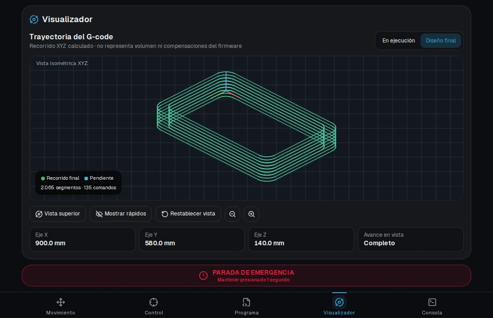
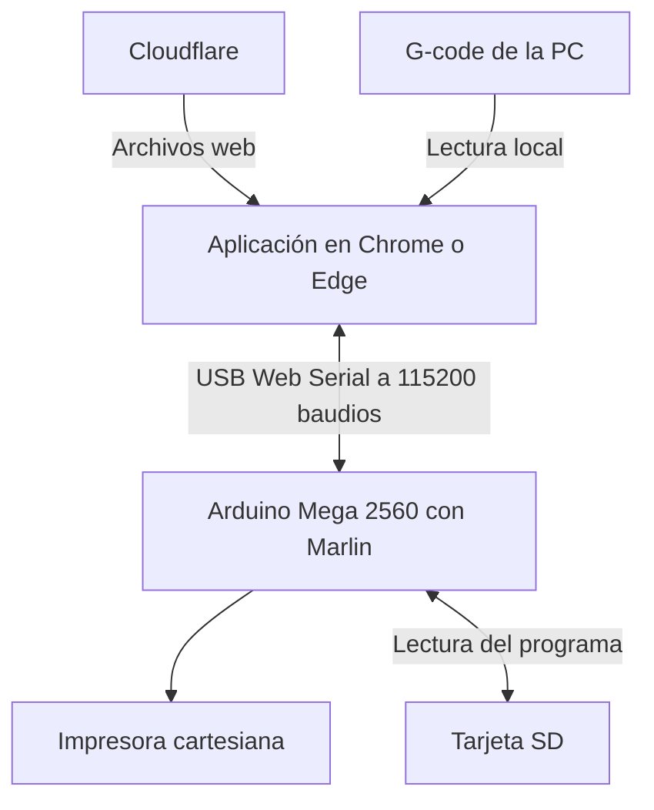
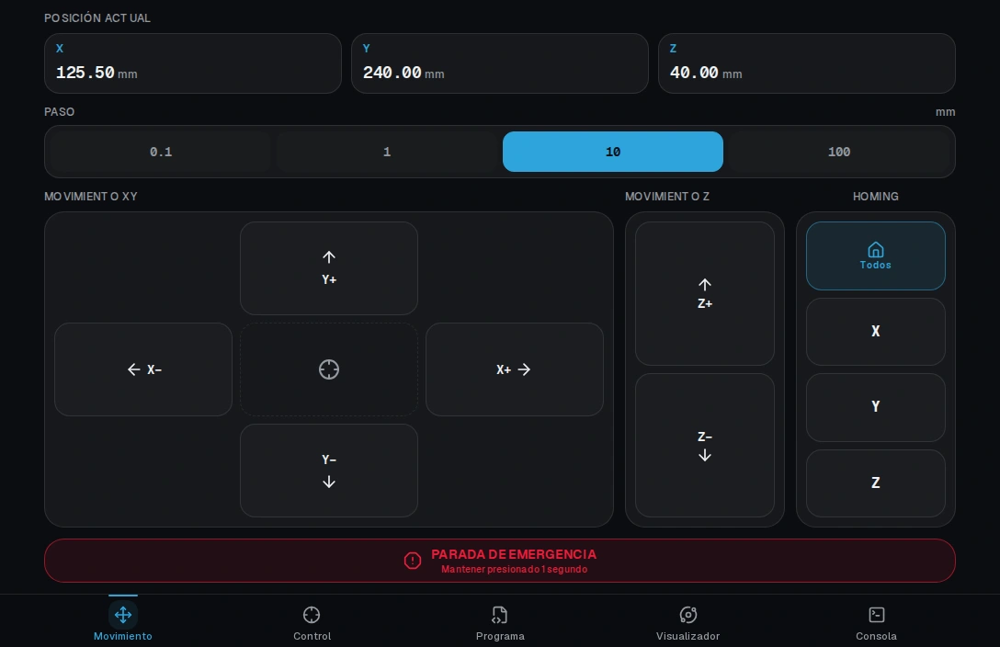
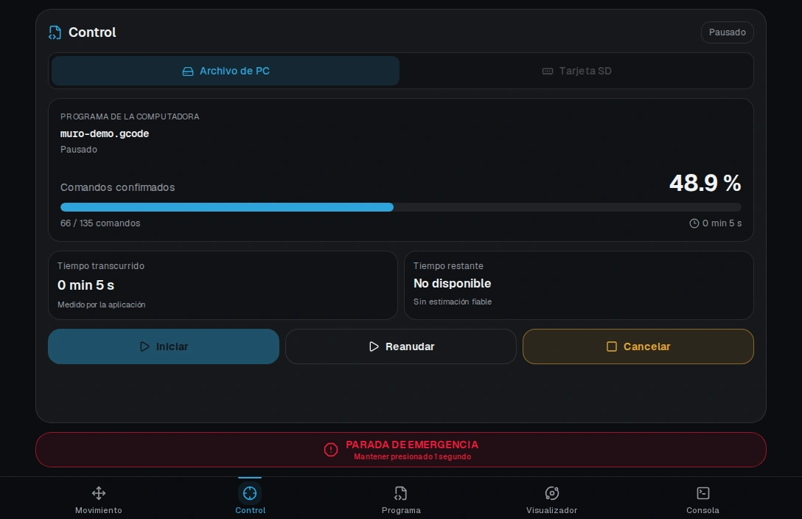
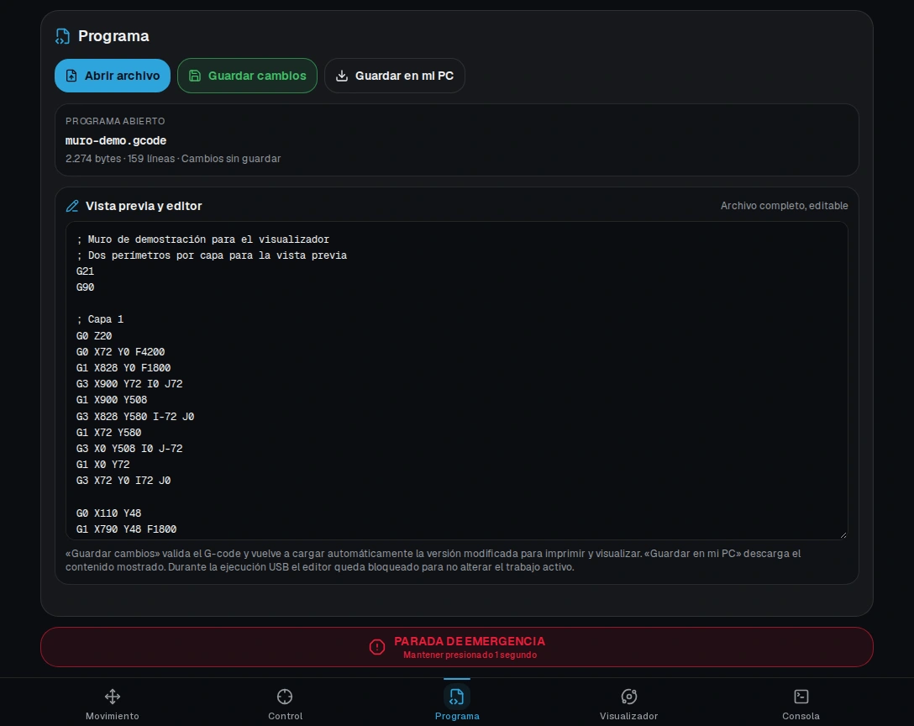
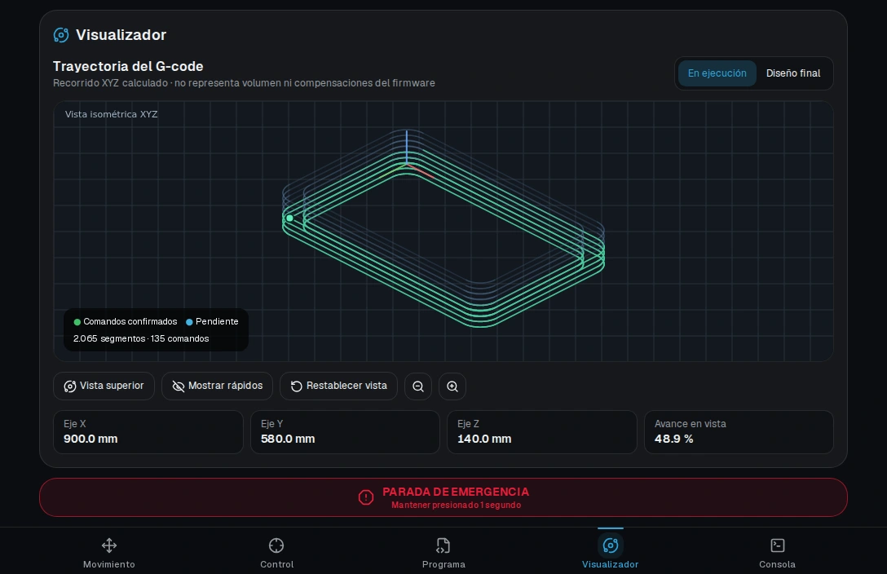
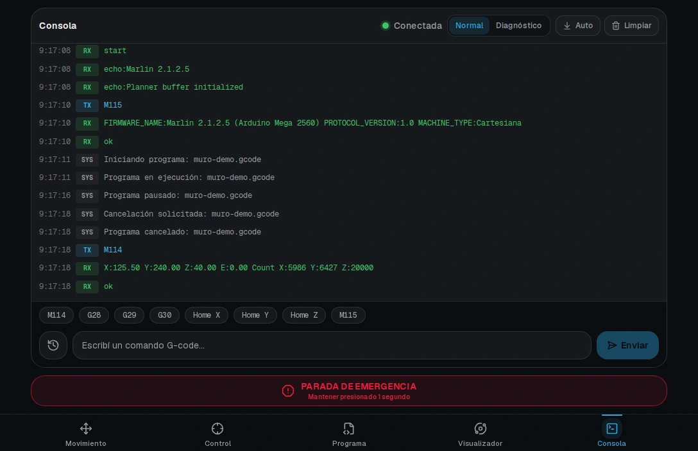
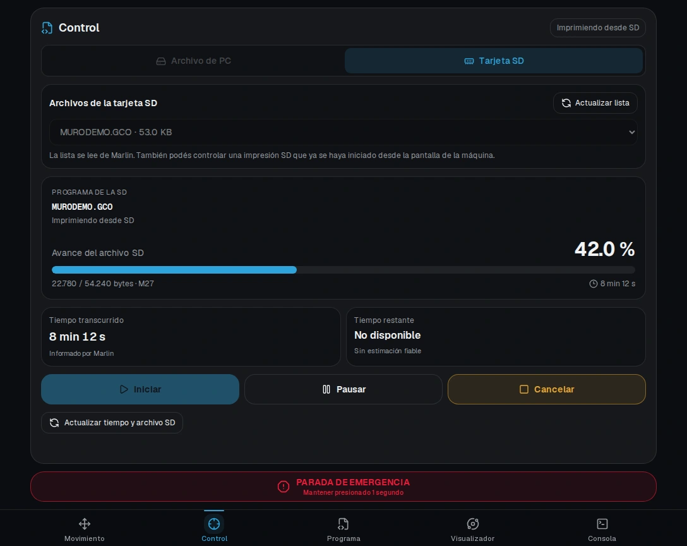

<div align="center">


# Controlador Impresora PC

### Control de escritorio por USB para una impresora 3D de viviendas

**Interfaz de operador · Comunicación serie · G-code · Marlin**


**[Interfaz](#interfaz-y-funcionalidades) · [Arquitectura](#arquitectura-del-sistema) · [Ejecución](#ejecución-de-programas) · [Puesta en marcha](#puesta-en-marcha) · [Validación](#validación)**

</div>



> Las imágenes son capturas de la aplicación en el navegador. Se usaron un archivo G-code de ejemplo y un puerto serie simulado para mostrar posiciones, respuestas y avances de demostración.

## Descripción general

**Controlador Impresora PC** reúne en una interfaz de escritorio el movimiento manual, la ejecución de programas y el diagnóstico de una impresora cartesiana de gran escala del **Astillero Río Santiago**. Se conecta por USB a una **Arduino Mega 2560** con **Marlin**. Desde la PC se pueden mover los ejes, hacer homing, consultar posiciones, editar un G-code, transmitirlo por USB o controlar un trabajo almacenado en la tarjeta SD de la máquina.

El controlador organiza la operación y muestra lo que informa Marlin. El firmware conserva la planificación del movimiento, el accionamiento de la máquina y el control del eje Z hidráulico. [Firmware de la impresora 3D de viviendas](https://github.com/BaltazarPatane/Impresora-3D-de-Viviendas)

## Origen y evolución

El punto de partida fue la interfaz oscura del controlador Wi-Fi basado en **ESP32-C3 v3.4**. La versión para PC conserva la distribución de controles y aprovecha la conexión directa de la computadora a la Mega. Se incorporó **Programa** para trabajar con archivos locales, una necesidad propia del puesto de escritorio.

| Etapa | Qué se resolvió |
| --- | --- |
| **Adaptación a escritorio** | Se conectó la interfaz a Web Serial y se incorporaron la selección del puerto, el reconocimiento de Marlin y la transmisión de G-code desde la PC. |
| **Interfaz v2.1** | Se simplificó el encabezado. La acción para conectar USB ocupa el lugar del botón de emergencia hasta que Marlin responde. |
| **Interfaz v2.2** | La edición quedó en Programa, el seguimiento USB/SD en Control y el recorrido en Visualizador. |
| **Interfaz v2.3** | El homing general e individual se agrupó junto a los mandos de Movimiento. |
| **Consola e identidad visual** | Se agregaron los modos Normal y Diagnóstico para consultar el intercambio serie con distinto nivel de detalle. El logo ARS 3D se incorporó al navegador y al manifiesto de instalación. |

## Arquitectura del sistema



La aplicación se construye con **Next.js, React, TypeScript y Tailwind CSS**. Next.js exporta HTML, JavaScript y recursos estáticos a `out/`. Cloudflare entrega esos archivos. Una vez abierta la interfaz, la lectura del G-code y el intercambio serie ocurren en la PC del operador. [Exportación estática de Next.js](https://nextjs.org/docs/app/guides/static-exports)

**Apertura del puerto y estado de la máquina.** El navegador pide autorización para acceder al puerto. Tras abrirlo a **115200 baudios**, la app espera el posible reinicio de la placa y confirma el enlace con la respuesta a `M115`. Después consulta el estado de la SD (`M27`) y las coordenadas (`M114`). Con un único puerto previamente autorizado, puede intentar abrirlo automáticamente al volver a entrar.

El estado de la conexión y la cola de comandos se mantienen al cambiar de pestaña. El espacio de Programa, Control y Visualizador también conserva el archivo abierto, el borrador y la selección de SD durante la navegación.

## Interfaz y funcionalidades

### Movimiento

Posiciones X, Y y Z informadas por Marlin, pasos de **0,1, 1, 10 y 100 mm**, mandos relativos de desplazamiento y homing general o por eje. Un desplazamiento usa `G91`, `G0` y `G90`, seguido de `M114` para actualizar las coordenadas que muestra la interfaz. El homing usa `G28`.



### Control

Desde una sola vista se elige el origen del programa, se inicia, se pausa, se reanuda o se cancela un trabajo y se consulta su estado. El avance indica qué parte del archivo recibió confirmación en USB o qué proporción de bytes informa Marlin en SD.



### Programa

Abre archivos `.gcode`, `.gco`, `.gc`, `.ngc` y `.txt` de hasta **20 MiB**. El editor muestra el archivo completo. **Guardar cambios** valida el formato y carga la nueva versión para ejecutar y visualizar. **Guardar en mi PC** descarga una copia del texto que se muestra en el editor. Durante un trabajo USB, la edición queda bloqueada.



### Visualizador

Reconstruye la **trayectoria XYZ** del G-code. Interpreta movimientos lineales `G0/G1`, arcos XY `G2/G3`, unidades `G20/G21`, modos absoluto y relativo `G90/G91` y cambios de coordenadas `G92`. Incluye vista isométrica o superior, rotación, zoom y un control para mostrar los desplazamientos rápidos.

**Diseño final** muestra el recorrido completo. **En ejecución** distingue los tramos confirmados de los pendientes según el avance disponible. La vista se limita a la trayectoria reconstruida del archivo. El volumen de material depositado, la cinemática hidráulica y las compensaciones aplicadas por Marlin se evalúan por separado.

Para mantener fluida la vista con programas grandes, el dibujo reduce la cantidad de segmentos representados. El transmisor toma sus comandos del archivo validado.



### Consola

Permite enviar G-code manual, revisar el historial y consultar las respuestas de Marlin. Los accesos rápidos preparan el comando en el campo de entrada para revisarlo antes del envío.

- **Normal** conserva el arranque, los comandos del operador y sus respuestas, los cambios de estado del trabajo y los avisos o errores relevantes.
- **Diagnóstico** conserva el intercambio serie detallado, incluidos `ok` por línea, sondeos de la SD, mensajes `echo:busy` y pedidos de retransmisión.

Durante una impresión, los sondeos periódicos y las confirmaciones por línea dificultaban encontrar los mensajes del operador. La consola clasifica las entradas por su origen y mantiene historiales de **500 entradas en Normal** y **1.500 en Diagnóstico**. El transporte procesa todas las respuestas para mantener el estado de la cola y el seguimiento del trabajo.



## Ejecución de programas

| Aspecto | Archivo de PC por USB | Tarjeta SD |
| --- | --- | --- |
| **Origen de las líneas** | La aplicación lee el archivo local y transmite las líneas por USB. | Marlin lee el archivo en la tarjeta de la máquina. |
| **Avance mostrado** | Comandos confirmados sobre comandos totales. | Bytes procesados sobre el tamaño del archivo, según `M27`. |
| **Tiempo transcurrido** | Medido por la aplicación durante la ejecución. | Informado por Marlin con `M31`. |
| **Si se pierde el enlace** | Se detiene el envío y la app marca el trabajo como interrumpido. | La ejecución está a cargo del firmware. Al reconectar, la app vuelve a consultar su estado. |

Los dos porcentajes miden el procesamiento del programa. El tiempo restante figura como **No disponible** porque la duración depende de los movimientos, las esperas y el comportamiento de la máquina.

### Archivo de PC por USB

Abrí el archivo en **Programa** y después elegí **Archivo de PC → Iniciar** en **Control**. Mantené la pestaña abierta y el USB conectado durante la ejecución.

1. **Preparación.** Se eliminan comentarios y líneas vacías. Se verifican caracteres ASCII y un máximo de 76 caracteres por comando, para reservar espacio para el número de línea y el checksum en el búfer de Marlin. El archivo de entrada se exporta sin numeración previa.
2. **Envío confirmado.** La app reinicia la numeración con `M110 N0` y envía un comando por vez con número de línea y checksum XOR. Cada `ok` permite avanzar incluso si el planificador todavía tiene movimientos pendientes. Ante un pedido `Resend`, la app retransmite la línea registrada si está en el historial reciente. Si la línea solicitada quedó fuera del historial, el trabajo se interrumpe.
3. **Pausa, cancelación y finalización.** En estos puntos el controlador deja de alimentar la cola y espera `M400`, que sincroniza los movimientos planificados. Una pausa confirmada conserva el punto de envío para reanudar. Si se pierde el USB o se reinicia la placa, el estado pasa a **Interrumpido** y la reanudación automática queda deshabilitada. [Marlin · M400](https://marlinfw.org/docs/gcode/M400.html)

### Tarjeta SD

Con la tarjeta cargada en la máquina, abrí **Control → Tarjeta SD → Actualizar lista**. Elegí el archivo y pulsá **Iniciar**.

La lista proviene de `M20`. Al iniciar, se envía `M23` y se exige la confirmación de apertura del archivo antes de enviar `M24`. La pausa usa `M25`, la reanudación usa `M24` y la cancelación usa `M524`. La app consulta `M27` para conocer el avance y `M27 C` para identificar el archivo abierto. También puede seguir un trabajo iniciado desde la pantalla de la máquina. [Marlin · M27](https://marlinfw.org/docs/gcode/M027.html)

Para visualizar un trabajo de la SD, abrí en **Programa** una copia local del mismo archivo. En ese caso, el trazado progresivo usa la proporción de bytes como referencia aproximada.



## Operación y seguridad

> [!IMPORTANT]
> **Ante una emergencia, usá el paro físico de la máquina.** La parada de la aplicación depende del navegador, del enlace USB y de que Marlin reciba el comando.

Con el enlace activo, mantener presionado **Parada de emergencia** durante **un segundo** bloquea los controles en la interfaz y envía `M112` por fuera de la cola normal de la app. Su tratamiento en Marlin depende de la configuración del firmware, incluida la opción `EMERGENCY_PARSER`. La pausa y la cancelación por USB permiten que terminen los movimientos ya aceptados por el planificador. [Marlin · M112](https://marlinfw.org/docs/gcode/M112.html)

La aplicación bloquea los mandos de Movimiento y homing durante un trabajo activo. En Control, el inicio de un trabajo USB o SD requiere que la otra fuente esté libre. Si la máquina también tiene otro host conectado, como el controlador Wi-Fi, operá desde un solo canal a la vez.

## Puesta en marcha

### Requisitos

- Una PC con **Chrome o Edge de escritorio** y soporte de Web Serial. Abrí el sitio por **HTTPS** o en **localhost**. [MDN · Web Serial API](https://developer.mozilla.org/en-US/docs/Web/API/Web_Serial_API)
- Una **Arduino Mega 2560** con Marlin configurado a **115200 baudios** y un cable USB de datos. Para ejecutar trabajos desde tarjeta, el firmware debe tener soporte SD habilitado.
- **Node.js 22** y npm para ejecutar o compilar el proyecto en local.

### Ejecución local

```bash
git clone https://github.com/BaltazarPatane/Controlador-Impresora-PC.git
cd Controlador-Impresora-PC
npm ci
npm run dev
```

1. Abrí el servidor local en el navegador. [http://localhost:3000](http://localhost:3000)
2. Conectá la Mega por USB y cerrá cualquier aplicación que tenga el puerto abierto, como Pronterface.
3. Pulsá **Conectar USB**, seleccioná el puerto y esperá la confirmación de Marlin.
4. Para comprobar la comunicación antes de accionar la máquina, verificá en **Consola** las respuestas a `M115` y `M114`.

### Compilación y publicación

```bash
npm run build
```

La salida de producción queda en `out/`. Para servir esa compilación en la propia PC, ejecutá `python3 -m http.server 8000 --bind 127.0.0.1 --directory out` y abrí [http://localhost:8000](http://localhost:8000).

En **Cloudflare Workers**, el repositorio incluye `wrangler.jsonc` con `out/` como directorio de recursos estáticos. Si usás Workers Builds, seleccioná `main` y configurá `npm run build` como comando de compilación y `npx wrangler deploy` como comando de despliegue. En **Cloudflare Pages**, configurá la misma compilación y `out` como directorio de salida. [Cloudflare · Static Assets](https://developers.cloudflare.com/workers/static-assets/)

## Validación

Las pruebas cubren la preparación y el envío confirmado de programas, las transiciones de pausa y cancelación, la lectura de respuestas de SD, la reconstrucción geométrica, el filtro de consola y la pulsación sostenida de emergencia. También verifican la navegación y la distribución de mandos. [Pruebas del repositorio](tests/)

```bash
node --test tests/*.test.cjs
node --experimental-strip-types --test tests/*.test.mjs
npm test
npm run typecheck
npm run build
```

GitHub Actions ejecuta las suites principales, verifica TypeScript y comprueba la generación de `out/index.html`. Las pruebas de protocolo y las capturas usan un transporte simulado. La validación de los movimientos, la SD y la parada sobre la impresora requiere un ensayo con el equipo físico. [Flujo de integración continua](.github/workflows/build.yml)

## Archivos principales

| Ruta | Responsabilidad |
| --- | --- |
| [`app/`](app/) y [`components/`](components/) | Entrada de la aplicación, navegación, pantallas y controles. |
| [`lib/printer-store.tsx`](lib/printer-store.tsx) | Estado compartido, conexión, acciones de operador y seguimiento USB/SD. |
| [`lib/web-serial-printer-transport.ts`](lib/web-serial-printer-transport.ts) | Lectura y escritura USB, cola de comandos, ACK, checksum y reenvío. |
| [`lib/gcode-job.ts`](lib/gcode-job.ts) | Preparación del G-code y ciclo de vida del trabajo transmitido por USB. |
| [`lib/sd-card.ts`](lib/sd-card.ts) y [`lib/sd-print-report.ts`](lib/sd-print-report.ts) | Interpretación de la lista de archivos, la confirmación de apertura y los reportes SD. |
| [`lib/gcode-geometry.ts`](lib/gcode-geometry.ts) y [`components/gcode-visualizer.tsx`](components/gcode-visualizer.tsx) | Cálculo y dibujo de la trayectoria. |
| [`lib/console-log-policy.ts`](lib/console-log-policy.ts) | Visibilidad de las entradas en la consola Normal. |
| [`docs/img/`](docs/img/) | Capturas de la interfaz con datos de demostración. |

---

<p align="center">
  Proyecto desarrollado por <strong><a href="https://github.com/BaltazarPatane">Baltazar Patané</a></strong>.
</p>
